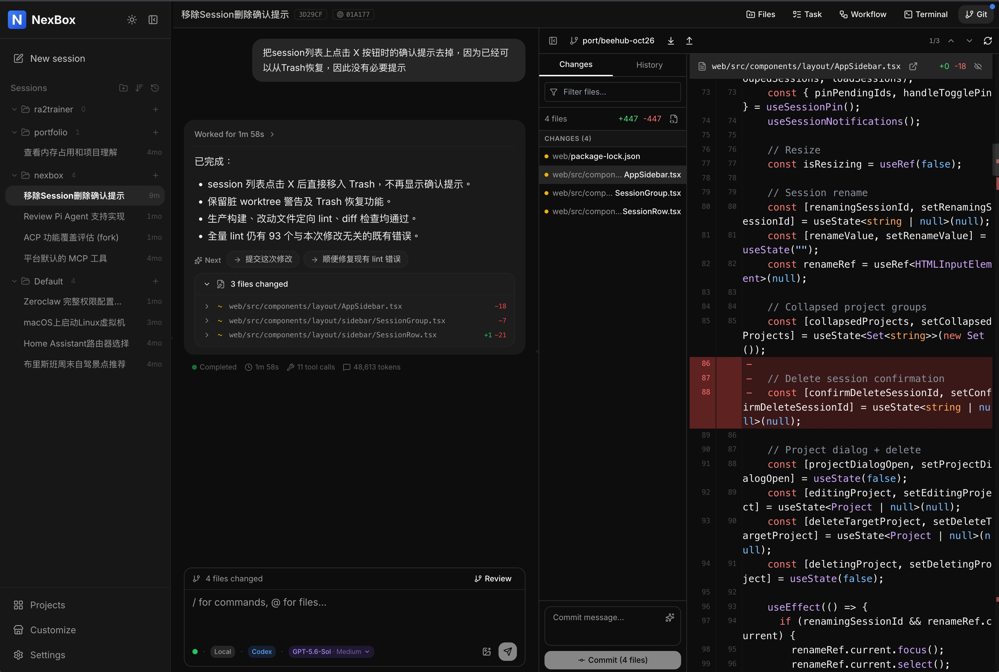

# NexBox

A personal workspace for using coding agents in your browser.

NexBox brings conversations, source files, Git, terminals, and workflows together in a single interface. It runs on your computer or your own server and directly invokes the agent CLIs configured on that machine. The frontend is bundled with the Go service, so only a single executable is needed at runtime—there is no separate frontend to deploy or desktop shell to install.



## Features

- **Multi-agent conversations**: Claude Code, Codex, Pi, Kimi Code, ZeroClaw, and Crush, with streaming text, reasoning, and tool calls.
- **Session management**: Resume and fork conversations, pin sessions, sort by activity, and send follow-up messages while an agent is running when supported by the backend.
- **Code workspace**: File browsing, search, a Monaco editor, tool-call diffs, and a multi-repository Git panel.
- **Terminal and browser**: An integrated terminal and optional Chrome browser tools.
- **Reusable capabilities**: Prompt templates, MCP, Skills, with both project-level and global installation.
- **Task automation**: Workflows, scheduling, and cross-session collaboration.

## Quick Start

> Install Git and make sure at least one [supported agent CLI](docs/agents.md) is configured and can run independently under the same system account that will run NexBox.
>
> NexBox itself does not require Go, Node.js, npm, or the source directory to run. Individual agent CLIs may have their own dependencies. For source builds, see the [development guide](docs/development.md#prerequisites).

### 1. Download

Download the archive for your platform from the [latest release](https://github.com/esonic/nexbox/releases/latest): Linux AMD64, Linux ARM64, or macOS Apple Silicon. On Windows, use the Linux archive inside WSL2.

### 2. Start

Extract the archive into a writable directory, open a terminal there, and start NexBox:

```bash
chmod +x nexbox
./nexbox
```

### 3. Open Workspace

Open <http://127.0.0.1:9040>. Select a configured agent to start a conversation, or create a project and connect it to an existing source directory.

### Optional: Enable Password Login

A new installation allows access without signing in. For remote access or sharing with trusted users, add a local account to enable password login:

```bash
read -r -s -p 'Password: ' NEXBOX_PASSWORD
printf '\n'
./nexbox add-user local "$NEXBOX_PASSWORD"
unset NEXBOX_PASSWORD
```

Run this in another terminal while NexBox is running. If you start the service with a custom data directory, replace the `add-user` line above with the following, using the same directory:

```bash
./nexbox add-user --data-dir /path/to/data local "$NEXBOX_PASSWORD"
```

Adding the first account enables password login immediately, with no restart required. Existing projects and sessions are assigned to that account, and files stay in place. Deleting the last account restores passwordless access. Instances with existing accounts still require sign-in after an upgrade.

Accounts are local to your NexBox instance and require no external registration. For password resets and other account commands, see [Local Accounts](docs/ops_manual.md#local-accounts).

## Common Settings

```bash
./nexbox --help        # Show server options and account commands
./nexbox --port 9050   # Use a different port
```

By default, NexBox stores its data in the directory containing the executable. To use a separate data directory:

```bash
./nexbox --data-dir /path/to/data
```

Account commands and the server must use the same data directory. The `--data-dir` option works for both.

For remote access, server deployment, and upgrades, see the [operations guide](docs/ops_manual.md).

## Documentation

- [Deployment, Configuration, and Maintenance](docs/ops_manual.md): Local operation, server deployment, data directories, and upgrades.
- [Agent Support](docs/agents.md): CLIs, protocols, model selection, and capability limitations.
- [Architecture](docs/architecture.md): Processes, storage, and workspace semantics.
- [Marketplace and MCP](docs/marketplace.md): Sources, installation scopes, authorization, and availability.

## Contributing and Security

See the [development guide](docs/development.md) for build requirements, source builds, development servers, tests, and code structure. See [CONTRIBUTING.md](CONTRIBUTING.md) for development checks and pull request
guidance. Report vulnerabilities privately according to
[SECURITY.md](SECURITY.md); do not put credentials or exploit details in a
public issue. Bundled dependency licenses are listed in
[THIRD_PARTY_NOTICES.md](THIRD_PARTY_NOTICES.md).
