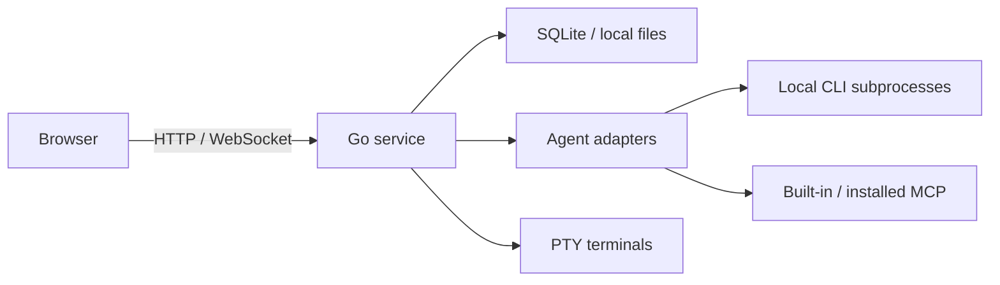

# Architecture

NexBox separates the browser interface from the local service. Deployments use a single Go executable with embedded frontend assets; development can run Go and Vite separately.

## Processes and Storage

HTTP handles projects, files, Git, and application settings. WebSocket carries conversation events, state changes, and terminal data. `server/api/` coordinates requests, while `server/store/` provides SQLite data operations.

`server/agent/` maps each CLI's machine protocol to text, reasoning, tool, interactive question, and completion events. Continuation identifiers, checkpoints, model catalogs, and capability limitations remain within the corresponding adapter. Higher layers use capability declarations to determine which operations to present.

CLI and PTY processes share the service's system account and environment. NexBox is intended for local use or self-hosting for trusted users. Project directories, Git worktrees, and local accounts are not separate operating system sandboxes.

## Optional Accounts

When there are no login accounts, API and WebSocket requests use an internal passwordless user as the project owner. No login credentials are issued, and the interface does not display this internal identity. Adding the first account transfers existing projects to it in the same transaction. Sessions follow project ownership, and files stay in place. Deleting the last account returns projects to the internal user.

When login accounts exist, authentication uses passwords and JWT cookies. Each request reads the current mode, and existing WebSocket connections also detect mode changes, so adding or deleting accounts requires no service restart.

## Projects and Workspaces

A project is associated with a working directory, either created by NexBox or connected to an existing path. The Git panel discovers workspace repositories through `server/gitrepo/` and resolves operation scopes by repository ID.

Sessions can use the project directory directly or create separate Git worktrees. Workflows can also own worktrees. Forking inherits the parent session's current directory rather than creating a filesystem snapshot; see [Agent Support](agents.md#sessions-and-forking).

The recycle bin retains recoverable sessions. Before removing a worktree, NexBox checks references from retained sessions and pending or running workflows. Hidden sessions, recycled sessions, subdirectories, and symlink paths are included in reference checks. Directories are retained if reference lookup fails.

## MCP and Marketplace

Built-in MCP exposes NexBox capabilities, and browser MCP manages Chrome per session. Installed HTTP MCP connections are initialized and their tools discovered before each turn. A proxy handles authorization and tool name mapping. Agent CLIs manage stdio MCP. See [Marketplace and MCP](marketplace.md) for details.

SQLite stores application records. Project files, Git worktrees, attachments, browser data, and native agent sessions may live in separate directories. See the [operations guide](ops_manual.md#data-and-working-directories) for runtime and data paths.
