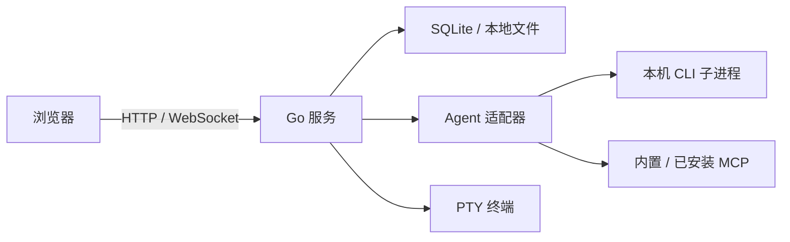

# 架构说明

NexBox 采用浏览器与本地服务分离的结构。部署时是一个包含前端资源的 Go 可执行文件；开发时可分别运行 Go 与 Vite。

## 进程与存储

HTTP 负责项目、文件、Git 和应用设置等操作；WebSocket 传递对话事件、状态变更和终端数据。`server/api/` 协调请求，`server/store/` 提供 SQLite 数据操作。

`server/agent/` 将各 CLI 的机器协议统一映射为文本、思考、工具、交互问题与完成事件。续聊标识、checkpoint、模型目录和能力限制保留在对应适配器内。上层通过能力声明决定如何呈现可用操作。

CLI 和 PTY 使用服务进程的系统账号与运行环境。NexBox 适合本地或可信用户自托管；项目目录、Git worktree 和本地账号不构成独立操作系统沙箱。

## 项目与工作区

项目关联一个工作目录，可以由 NexBox 创建，也可以接入已有路径。Git 面板通过 `server/gitrepo/` 发现工作区内的仓库，并以 repository ID 解析操作范围。

会话可直接使用项目目录，也可创建独立 Git worktree。工作流也可持有自己的 worktree。会话分叉继承父会话当前目录，而不是创建文件系统快照；参见 [Agent 支持](agents.md#会话与分叉)。

回收站保留可恢复的会话。清理 worktree 前检查仍存留的会话和 pending/running 工作流引用；隐藏会话、回收站中的会话、子目录及符号链接路径也参与引用判断。引用查询失败时保留目录。

## MCP 与市场

内置 MCP 提供 NexBox 功能，浏览器 MCP 按会话管理 Chrome。市场安装的 HTTP MCP 在每轮对话前初始化并发现工具，通过代理统一处理授权和名称映射。stdio MCP 由各 CLI 管理。具体行为见 [Marketplace 与 MCP](marketplace.md)。

SQLite 保存应用记录；项目文件、Git worktree、附件、浏览器数据和 Agent 原生会话可能位于独立目录。运行与数据路径见[部署文档](ops_manual.md#数据与工作目录)。
