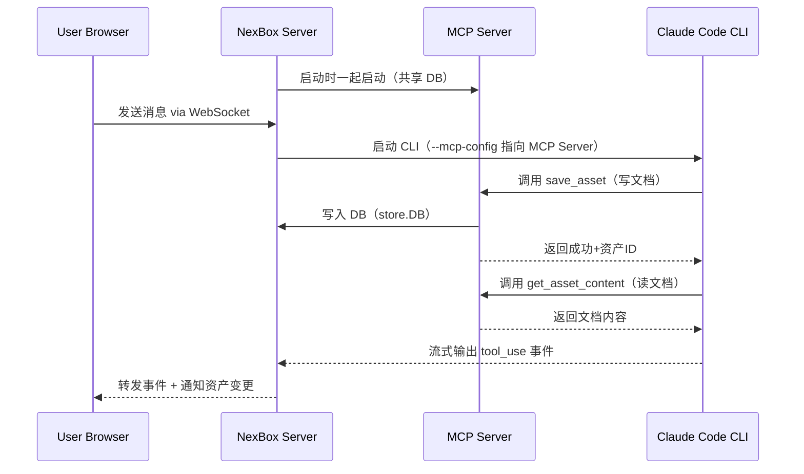

# Asset MCP Integration

## 架构总览




## Phase A: MCP Server（后端核心）

新建 `server/mcp/` 包，使用 [mcp-go](https://github.com/mark3labs/mcp-go) 库实现 HTTP 传输的 MCP Server。

### A.1 新建 `server/mcp/server.go`

- 创建 MCP Server，注册三个工具
- HTTP 传输，监听 `127.0.0.1:<port>`（端口可配置，默认 9090）
- 需要注入 `*store.DB` 以访问数据库

三个 MCP 工具定义：

`**save_asset**` — AI 调用此工具保存/更新文档资产

- 参数：`iteration_id`（string, required）、`type`（enum: requirement_doc/design_doc/code_change/unit_test/test_case, required）、`title`（string, required）、`content`（string, required）
- 逻辑：先按 iteration_id + title 查找现有资产，存在则更新（新版本），不存在则创建
- 返回：`"Asset saved: {title} (v{version}, id: {id})"`

`**get_asset_content**` — AI 调用此工具按需读取资产内容

- 参数：`iteration_id`（string, required）、`title`（string, required）
- 逻辑：调用 `store.FindAssetByTitle` + `store.GetLatestAssetContent`
- 返回：资产的完整 Markdown 内容

`**list_assets**` — AI 调用此工具获取最新资产列表

- 参数：`iteration_id`（string, required）
- 逻辑：调用 `store.ListAssets(iteration_id)`
- 返回：JSON 格式的资产列表（id, type, title, version, status）

### A.2 store 新增方法

在 `server/store/assets.go` 中新增：

- `FindAssetByTitle(iterationID, title string) (*models.Asset, error)` — 按标题查找资产（用于 save_asset 的 upsert 逻辑）

### A.3 `server/main.go` 启动 MCP Server

- 新增 `--mcp-port` 命令行参数（默认 9090）
- 在 main() 中启动 MCP Server goroutine，与 NexBox HTTP Server 并行运行
- MCP Server 共享同一个 `store.DB` 实例

## Phase B: Engine 集成

### B.1 修改 `server/agent/engine.go`

`Engine` 结构体新增字段：

```go
type Engine struct {
    ClaudeConfigDir string
    MCPServerURL    string // e.g. "http://127.0.0.1:9090/mcp"
}
```

### B.2 修改 `buildCLIArgs`

当 `MCPServerURL` 非空时：

1. 生成 MCP 配置 JSON 字符串：

```json
{"mcpServers":{"nexbox":{"type":"http","url":"http://127.0.0.1:9090/mcp"}}}
```

1. 写入临时文件（`os.CreateTemp`），将路径传给 `--mcp-config`
2. 添加 `--strict-mcp-config`（确保只用我们的 MCP，不受用户本地配置干扰）
3. 在 `--allowedTools` 中追加 MCP 工具名：`mcp__nexbox__save_asset,mcp__nexbox__get_asset_content,mcp__nexbox__list_assets`

### B.3 修改 `SendMessage` 清理临时文件

在 `cmd.Wait()` 之后清理临时 MCP config 文件。

## Phase C: System Prompt 增强

### C.1 修改 `server/agent/context.go` — `BuildSystemPrompt`

改造 Assets 上下文注入：

- **短资产**（内容 <= 2000 字符）：直接将全文注入 system prompt
- **长资产**（内容 > 2000 字符）：只注入前2000字符 + 截断提示，引导 AI 使用 `get_asset_content` 工具按需读取

新增 MCP 工具使用指引：

```
[Asset Management Tools]
You have access to NexBox asset management tools via MCP:
- save_asset: Save a document as a versioned asset. Use this whenever you generate design docs, test cases, or other documents that should be persisted. The iteration_id for the current context is: {iteration_id}.
- get_asset_content: Read the full content of an existing asset by title.
- list_assets: List all assets in an iteration.

IMPORTANT: When the user asks you to write a design document, test cases, or any structured document, ALWAYS use the save_asset tool to persist it as an asset. Do not just print it in the chat.
```

### C.2 `BuildSystemPrompt` 签名变更

接收 `[]AssetWithContent`（包含资产及其内容）和 `hasMCP bool`，由调用方在 `chat.go` 中预加载。

### C.3 修改 `server/api/chat.go`

在构建 system prompt 之前，为每个资产加载最新内容：

```go
var assetsWithContent []agent.AssetWithContent
for _, a := range assets {
    content, _ := s.DB.GetLatestAssetContent(a.ID)
    assetsWithContent = append(assetsWithContent, agent.AssetWithContent{
        Asset:   a,
        Content: content,
    })
}
hasMCP := s.AgentEngine.MCPServerURL != ""
systemPrompt := agent.BuildSystemPrompt(project, iteration, assetsWithContent, hasMCP)
```

## Phase D: 前端通知

### D.1 ToolCallCard 识别 MCP 工具

在 `web/src/components/chat/ToolCallCard.tsx` 的工具注册表中，为 MCP 工具添加友好的图标和名称：

- `mcp__nexbox__save_asset` → icon: Save, label: "Saving asset" / "Saved asset"
- `mcp__nexbox__get_asset_content` → icon: BookOpen, label: "Reading asset" / "Read asset"
- `mcp__nexbox__list_assets` → icon: List, label: "Listing assets" / "Listed assets"

### D.2 前端处理

在 `web/src/components/chat/ChatPanel.tsx` 中：

- 当收到 `tool_result` 且对应的 `tool_use` 为 `mcp__nexbox__save_asset` 时，触发 `onAssetCreated` 回调
- AssetList 组件自动刷新

## Phase E: 测试

- `server/mcp/mcp_test.go`：测试 MCP tool handler 的正确性（save/get/list，含各种边界情况）
- `server/agent/agent_test.go`：新增 `TestBuildCLIArgs_WithMCPConfig`、`TestWriteMCPConfig`、`TestBuildSystemPrompt_WithMCP`、`TestBuildSystemPrompt_LongAssetTruncated`
- `server/store/store_test.go`：新增 `TestFindAssetByTitle`、`TestFindAssetByTitle_NotFound`、`TestFindAssetByTitle_IsolatedByIteration`

## 文件变更总览

**新建：**

- `server/mcp/server.go` — MCP Server 启动、工具注册、handler 实现
- `server/mcp/mcp_test.go` — MCP handler 测试

**修改：**

- `server/main.go` — 启动 MCP Server，新增 `--mcp-port` 参数
- `server/agent/engine.go` — 新增 `MCPServerURL` 字段，`buildCLIArgs` 生成 MCP 配置
- `server/agent/context.go` — `BuildSystemPrompt` 注入资产内容 + MCP 工具指引
- `server/api/chat.go` — 预加载资产内容传给 BuildSystemPrompt
- `server/store/assets.go` — 新增 `FindAssetByTitle`
- `web/src/components/chat/ToolCallCard.tsx` — MCP 工具友好名称
- `web/src/components/chat/ChatPanel.tsx` — 资产变更通知
- `server/go.mod` — 添加 `github.com/mark3labs/mcp-go` 依赖
- `server/agent/agent_test.go` — MCP 相关测试
- `server/store/store_test.go` — FindAssetByTitle 测试
