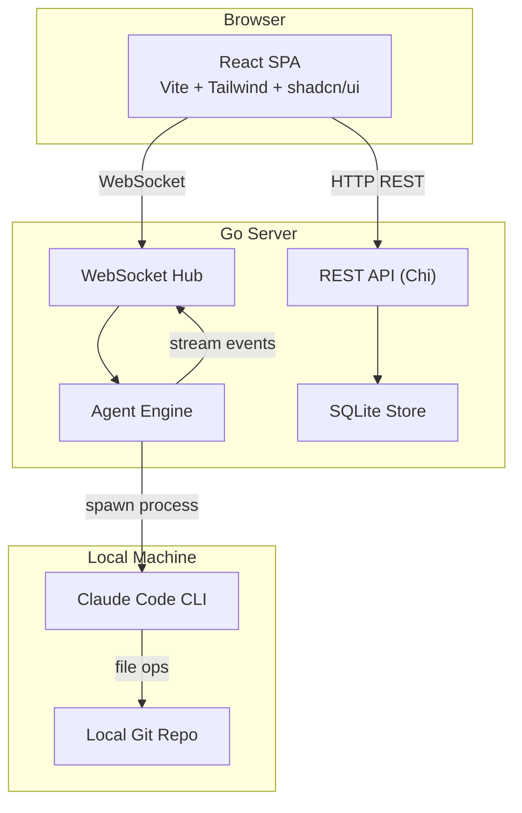

# NexBox Phase 1 MVP 实施方案

> 状态：已完成
>
> 日期：2026-02-09

---

## 1. 整体架构



## 2. 技术栈

**后端 (Golang)**

- 路由: `github.com/go-chi/chi/v5`
- WebSocket: `github.com/gorilla/websocket`
- 数据库: `modernc.org/sqlite` (纯 Go，无 CGO)
- Diff: `github.com/sergi/go-diff`
- UUID: `github.com/google/uuid`
- CORS: `github.com/rs/cors`

**前端 (参考 1code)**

- React 19 + TypeScript + Vite
- Tailwind CSS 3 + shadcn/ui (Radix UI)
- Monaco Editor (文档编辑 + 语法高亮)
- `@git-diff-view/react` (Diff 展示)
- TanStack Query (数据请求)
- Zustand (状态管理)
- Lucide React (图标)
- npm 包管理

## 3. 项目结构 (Monorepo)

```
NexBox/
├── server/                   # Go 后端
│   ├── main.go               # 入口，启动 HTTP 服务 + 静态文件托管
│   ├── go.mod
│   ├── api/
│   │   ├── router.go         # Chi 路由注册
│   │   ├── projects.go       # 项目 CRUD
│   │   ├── iterations.go     # 迭代 CRUD
│   │   ├── assets.go         # 资产 CRUD + 版本管理
│   │   ├── reviews.go        # Review 评论 CRUD
│   │   ├── chat.go           # WebSocket chat handler
│   │   └── helpers.go        # JSON 响应工具函数
│   ├── store/
│   │   ├── db.go             # SQLite 初始化 + 迁移
│   │   ├── projects.go       # 项目数据层
│   │   ├── iterations.go     # 迭代数据层
│   │   ├── assets.go         # 资产数据层
│   │   └── reviews.go        # Review 数据层
│   ├── agent/
│   │   ├── engine.go         # Claude Code CLI 封装
│   │   ├── session.go        # 会话管理 (session ID 映射)
│   │   └── context.go        # 上下文组装 (注入迭代/资产信息)
│   └── models/
│       └── models.go         # 数据模型定义
│
├── web/                      # React 前端
│   ├── package.json
│   ├── vite.config.ts
│   ├── tailwind.config.js
│   ├── src/
│   │   ├── main.tsx
│   │   ├── App.tsx           # 路由定义
│   │   ├── lib/
│   │   │   ├── api.ts        # REST API 客户端
│   │   │   ├── ws.ts         # WebSocket 客户端
│   │   │   └── utils.ts
│   │   ├── stores/
│   │   │   └── app.ts        # Zustand 全局状态
│   │   ├── components/
│   │   │   ├── ui/           # shadcn/ui 组件 (Button, Dialog, Tabs 等)
│   │   │   ├── layout/       # AppSidebar
│   │   │   ├── chat/         # ChatPanel, ChatMessage
│   │   │   ├── assets/       # AssetEditor, AssetList
│   │   │   ├── review/       # ReviewPanel
│   │   │   └── diff/         # DiffViewer
│   │   ├── pages/
│   │   │   ├── ProjectList.tsx
│   │   │   ├── ProjectDetail.tsx
│   │   │   └── IterationWorkspace.tsx   # 主工作页面
│   │   └── types/
│   │       └── index.ts
│
└── docs/
    ├── design-overview.md
    └── phase1-implementation.md  # 本文件
```

## 4. 数据库设计 (SQLite)

```sql
CREATE TABLE projects (
    id TEXT PRIMARY KEY,
    name TEXT NOT NULL,
    description TEXT DEFAULT '',
    git_repo_path TEXT DEFAULT '',
    created_at DATETIME DEFAULT CURRENT_TIMESTAMP,
    updated_at DATETIME DEFAULT CURRENT_TIMESTAMP
);

CREATE TABLE iterations (
    id TEXT PRIMARY KEY,
    project_id TEXT NOT NULL REFERENCES projects(id),
    title TEXT NOT NULL,
    requirement TEXT DEFAULT '',    -- 用户手动输入的需求描述 (替代 Jira)
    status TEXT DEFAULT 'in_progress',  -- in_progress | reviewing | completed
    branch_name TEXT DEFAULT '',
    session_id TEXT DEFAULT '',     -- Claude Code session ID
    created_at DATETIME DEFAULT CURRENT_TIMESTAMP,
    updated_at DATETIME DEFAULT CURRENT_TIMESTAMP
);

CREATE TABLE assets (
    id TEXT PRIMARY KEY,
    iteration_id TEXT NOT NULL REFERENCES iterations(id),
    type TEXT NOT NULL,            -- requirement_doc | design_doc | code_change | unit_test | test_case
    title TEXT NOT NULL,
    current_version INTEGER DEFAULT 1,
    status TEXT DEFAULT 'draft',   -- draft | reviewing | approved
    created_at DATETIME DEFAULT CURRENT_TIMESTAMP,
    updated_at DATETIME DEFAULT CURRENT_TIMESTAMP
);

CREATE TABLE asset_versions (
    id TEXT PRIMARY KEY,
    asset_id TEXT NOT NULL REFERENCES assets(id),
    version INTEGER NOT NULL,
    content TEXT NOT NULL,          -- 完整 Markdown 内容快照
    created_at DATETIME DEFAULT CURRENT_TIMESTAMP
);

CREATE TABLE review_comments (
    id TEXT PRIMARY KEY,
    asset_id TEXT NOT NULL REFERENCES assets(id),
    asset_version INTEGER NOT NULL,
    line_number INTEGER,
    content TEXT NOT NULL,
    author TEXT DEFAULT 'user',
    status TEXT DEFAULT 'open',    -- open | resolved
    created_at DATETIME DEFAULT CURRENT_TIMESTAMP
);
```

## 5. API 设计

**REST API (JSON)**

- `POST/GET /api/projects` - 项目列表和创建
- `GET/PUT/DELETE /api/projects/:id` - 项目详情
- `POST/GET /api/projects/:id/iterations` - 迭代列表和创建
- `GET/PUT /api/iterations/:id` - 迭代详情
- `POST/GET /api/iterations/:id/assets` - 资产列表和创建
- `GET/PUT /api/assets/:id` - 资产详情 (PUT 自动创建新版本)
- `GET /api/assets/:id/versions` - 版本列表
- `GET /api/assets/:id/diff?v1=X&v2=Y` - 两个版本间 Diff
- `POST/GET /api/assets/:id/comments` - Review 评论
- `PUT /api/comments/:id` - 更新/解决评论

**WebSocket `/ws/chat/:iterationId`**

客户端发送:

```json
{"type": "user_message", "content": "帮我生成设计文档"}
```

服务端推送 (流式):

```json
{"type": "assistant_text", "content": "好的，让我..."}
{"type": "tool_use", "tool": "Write", "input": {"path": "..."}}
{"type": "tool_result", "output": "..."}
{"type": "done", "session_id": "xxx"}
{"type": "error", "message": "..."}
```

## 6. Claude Code CLI 交互方式

**核心策略**: 每条消息 = 一次 `claude -p` 调用 + `--resume` 续接会话

- 首次消息 (新会话):
  ```bash
  claude -p "user message" \
    --output-format stream-json \
    --append-system-prompt "[NexBox Context] Project: X, Iteration: Y, Requirement: Z..." \
    --session-id <UUID> \
    --allowedTools "Bash,Read,Write,Edit,Grep,Glob" \
    2>/dev/null
  ```
  工作目录设为项目关联的 Git 仓库路径。
- 后续消息 (续接会话):
  ```bash
  claude -p "user message" \
    --resume <session-id> \
    --output-format stream-json \
    2>/dev/null
  ```
- 逐行读取 stdout 的 stream-json 事件，解析后通过 WebSocket 推送给前端。

## 7. 前端页面设计

**布局**: 左侧导航栏 + 主工作区

- **项目列表页**: 卡片式展示所有项目，创建项目对话框
- **迭代工作空间** (核心页面):
  - 左侧面板: 迭代信息 + 资产列表
  - 中间主区: AI 对话 (流式消息渲染，支持代码块高亮)
  - 右侧面板 (可折叠): 资产编辑器 / Diff 查看器 / Review 评论

**AI 对话界面参考 1code/Claude Code Web 风格**:

- 消息气泡区 (支持 Markdown 渲染、代码块语法高亮)
- 工具调用实时展示 (文件编辑、命令执行等)
- 底部输入框 + 发送按钮

## 8. 简化与预留

- **Jira**: 迭代创建时只有文本输入框，用户自行填写需求描述
- **GitLab**: 只关联本地 Git 仓库路径，不调用远程 API
- **变更/发布系统**: 数据模型中预留 `changes` 表结构，API 不实现
- **飞书/CLI**: 第一阶段不实现
- **沙箱**: 不做容器隔离，直接在本地 Git 仓库目录执行
- **认证**: 单用户模式，不做登录认证

## 9. 开发与运行方式

**开发模式**:

- 前端: `cd web && npm run dev` (Vite dev server, 代理 API 到 Go 后端)
- 后端: `cd server && go run .` (监听 :8080)

**生产模式**:

- `cd web && npm install && npm run build` → 生成 `web/dist/`
- `cd server && go run . --web-dir ../web/dist`
- 浏览器打开 `http://localhost:8080`

## 10. 实施清单

| # | 任务 | 状态 |
|---|------|------|
| 1 | 项目脚手架: Go module + React/Vite 项目 + 目录结构 + 依赖安装 | 已完成 |
| 2 | 数据库层: SQLite 初始化、迁移脚本、数据模型定义 | 已完成 |
| 3 | REST API: 项目/迭代/资产/评论的完整 CRUD | 已完成 |
| 4 | Agent 引擎: Claude Code CLI 封装、会话管理、上下文注入、stream-json 解析 | 已完成 |
| 5 | WebSocket: Chat handler，将 Claude Code 流式事件推送到前端 | 已完成 |
| 6 | 前端脚手架: React Router 路由、shadcn/ui 组件、布局框架 | 已完成 |
| 7 | 前端页面: 项目管理 + 迭代管理 (CRUD 界面) | 已完成 |
| 8 | AI 对话界面: 流式消息渲染、工具调用展示、Markdown/代码高亮 | 已完成 |
| 9 | 资产管理: 编辑器、版本列表、保存即新版本 | 已完成 |
| 10 | Diff 查看器: 两个版本间的文档对比展示 | 已完成 |
| 11 | 行内 Review: 文档/代码行级评论、评论列表、解决标记 | 已完成 |
| 12 | 集成联调: 前后端联通、静态文件嵌入、端到端流程验证 | 已完成 |
